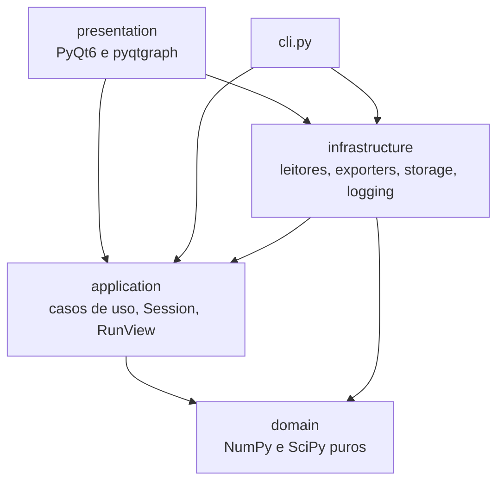
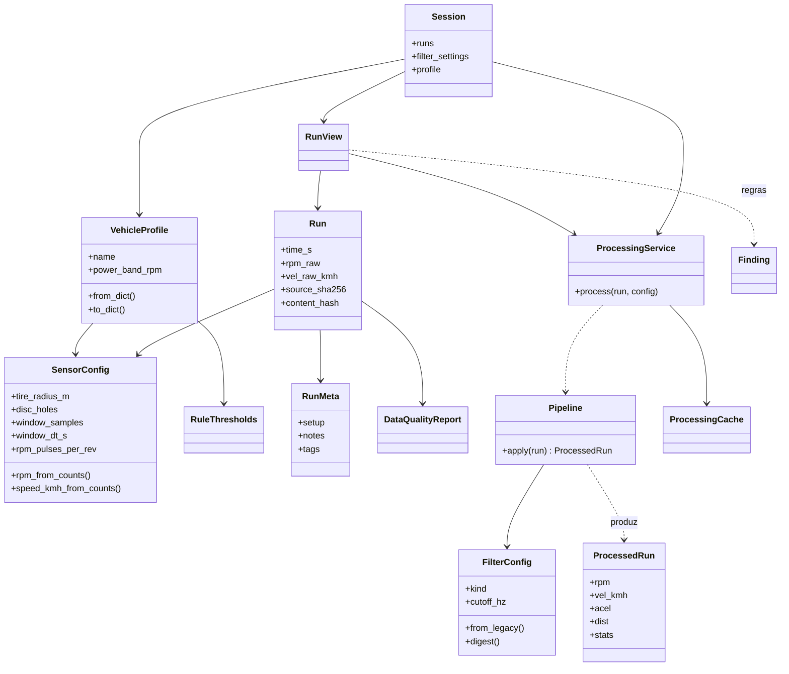
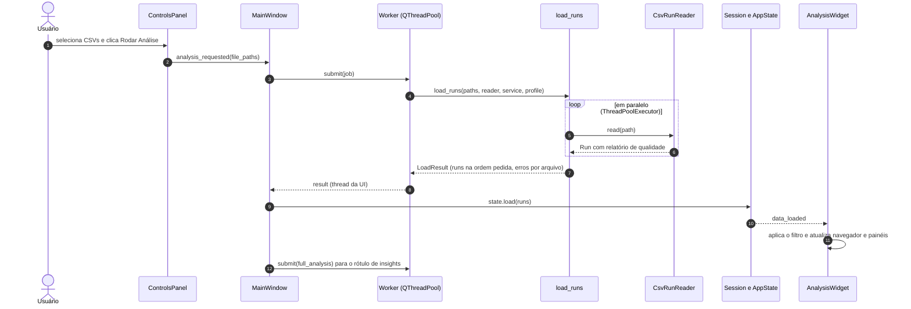
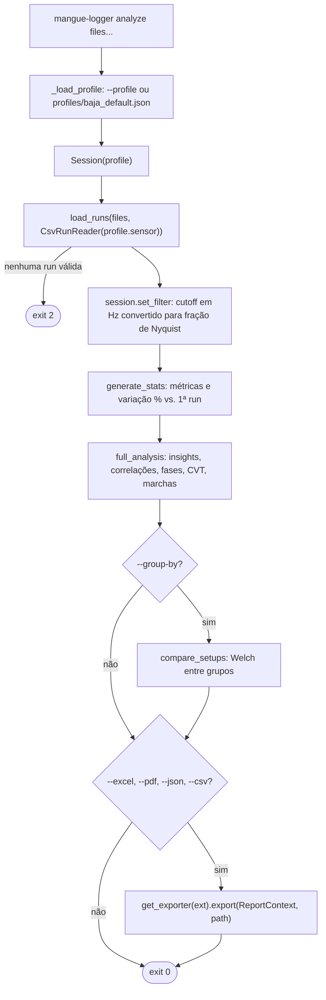
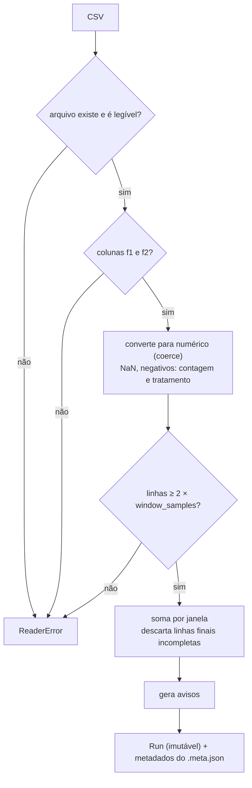
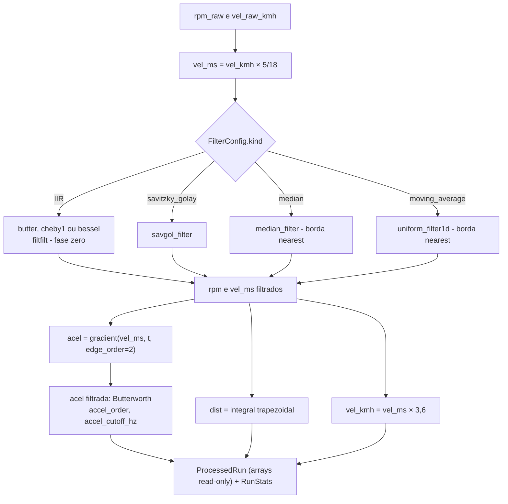
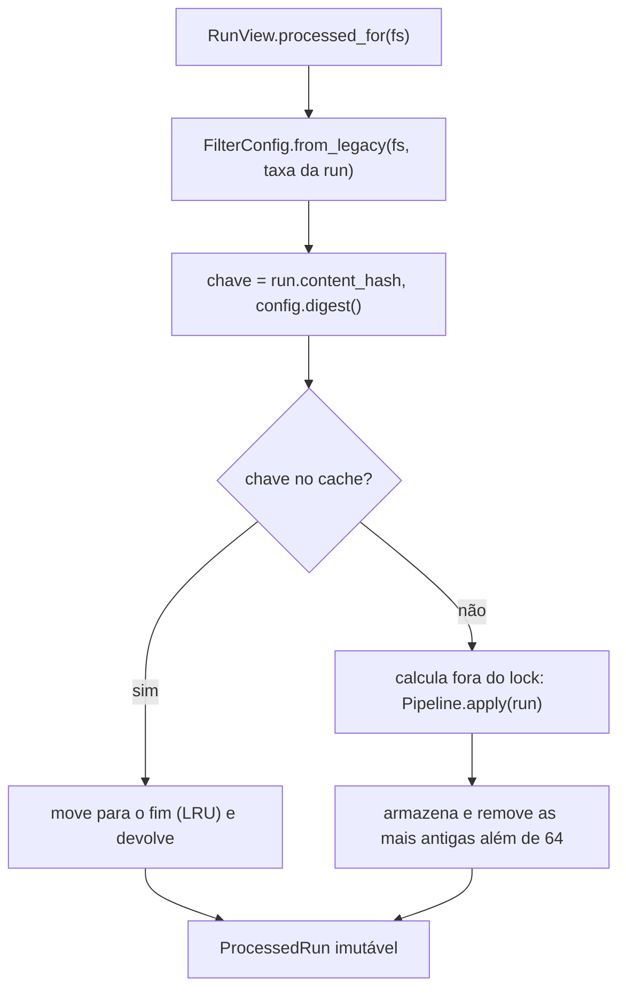
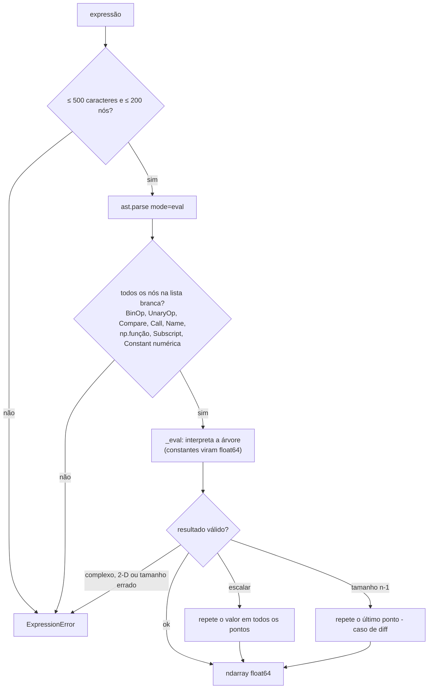

# Mangue Logger v7


Análise de telemetria do **Mangue Baja (UFPE)**. O Mangue Logger lê os CSVs de uma *run* (contagens de pulso dos sensores de disco de freio e de rotação), converte-as em **RPM, velocidade, aceleração e distância**, aplica filtros digitais, e oferece **análise de CVT, fases de condução, insights automáticos, comparação estatística entre setups** e relatórios em **Excel, PDF, JSON e CSV**. Funciona por **interface gráfica** ou por **linha de comando** (sem Qt), e é a evolução do iLogger/Mangue Logger v6.

---

## Sumário

1. [Visão geral](#1-visão-geral)
2. [Instalação](#2-instalação)
3. [Uso rápido](#3-uso-rápido)
4. [Arquitetura](#4-arquitetura)
5. [Modelo de dados e física](#5-modelo-de-dados-e-física)
6. [Pipeline de processamento](#6-pipeline-de-processamento)
7. [Cache de processamento](#7-cache-de-processamento)
8. [Análises e regras](#8-análises-e-regras)
9. [Canais virtuais](#9-canais-virtuais)
10. [Interface gráfica](#10-interface-gráfica)
11. [Linha de comando](#11-linha-de-comando)
12. [Exportação](#12-exportação)
13. [Persistência e arquivos](#13-persistência-e-arquivos)
14. [Perfil do veículo](#14-perfil-do-veículo)
15. [Geração de CSV via DLL](#15-geração-de-csv-via-dll)
16. [Desenvolvimento](#16-desenvolvimento)
17. [Solução de problemas](#17-solução-de-problemas)
18. [Limitações conhecidas e melhorias sugeridas](#18-limitações-conhecidas-e-melhorias-sugeridas)
19. [Migração da v6](#19-migração-da-v6)
20. [Equipe](#20-equipe)

---

## 1. Visão geral

| Recurso | Descrição |
|---|---|
| **Entrada** | CSV com as colunas `f1` (sensor de disco de freio → velocidade) e `f2` (sensor de rotação → RPM). |
| **Qualidade de dados** | Cada run recebe um relatório (valores não numéricos, negativos, linhas descartadas, sensor desconectado, trechos sem pulsos). |
| **Processamento** | Pipeline imutável (`Run` → `ProcessedRun`) com 6 filtros digitais, cutoff em **Hz**, derivada, integral trapezoidal e estatísticas. |
| **Análises** | Fases de condução, **CVT** (RPM de saída e sustentado), faixa de potência, razões de marcha, FFT, histogramas, correlações de Pearson, anomalias (MAD). |
| **Insights** | Motor de regras com limiares do **perfil do veículo** (JSON validado), gerando `Finding` com nível `critical`, `warning`, `good` ou `info`. |
| **Comparação** | Variação % entre runs e **teste t de Welch** entre grupos de setups (IC 95 %, *d* de Cohen). |
| **Canais virtuais** | Expressões matemáticas avaliadas por um **interpretador de AST seguro** (sem `eval`). |
| **Persistência** | Workspace em `~/.mangue_logger/`, projetos reprodutíveis `.mlproj` (com SHA-256 das runs) e biblioteca de runs em SQLite. |
| **Interfaces** | GUI (PyQt6 + pyqtgraph) e CLI headless (`mangue-logger`). |
| **Robustez** | Tarefas pesadas em *workers*, erros com *traceback* + log rotativo, escrita atômica de JSON. |

---

## 2. Instalação

Requer **Python 3.10 ou superior**.

```bash
python -m venv .venv && source .venv/bin/activate      # Windows: .venv\Scripts\activate
pip install -e ".[gui,reports]"                         # app completo
pip install -e ".[gui,reports,dev]"                     # + ferramentas de desenvolvimento
```

| Extra | Pacotes | Para quê |
|---|---|---|
| *(núcleo)* | `numpy>=1.24`, `scipy>=1.11`, `pandas>=2.0` | Domínio, aplicação e CLI |
| `gui` | `PyQt6>=6.5`, `pyqtgraph>=0.13.3` | Interface gráfica |
| `reports` | `xlsxwriter>=3.1`, `reportlab>=4.0`, `matplotlib>=3.7` | Excel e PDF |
| `dev` | `pytest`, `pytest-qt`, `hypothesis`, `ruff`, `mypy`, `pandas-stubs`, `pyinstaller` | Testes, qualidade e empacotamento |

O `requirements.txt` existe só por compatibilidade com o fluxo antigo (equivale a `.[gui,reports]`).

---

## 3. Uso rápido

```bash
mangue-logger-gui                                       # interface gráfica (ou: python -m mangue_logger gui)

# CLI (sem Qt) — bom para lote e CI
mangue-logger quality runs/*.csv                        # só qualidade dos dados
mangue-logger analyze run1.csv run2.csv --cutoff-hz 1.5 --excel out.xlsx --pdf out.pdf
mangue-logger analyze runs/*.csv --group-by peso_cvt --metric vel_max   # Welch entre setups
```

Exemplo de saída do `analyze` (dados sintéticos, trecho):

```
Arquivo                a.csv    c.csv
Vel. Máx (Km/h)        76.76    77.07
Vel. Média (Km/h)      41.33    44.37
RPM Máx              8772.16  8417.05
Acel. Máx (m/s²)       17.70    14.22
Distância Total (m)   344.39   369.78
Duração (s)            29.95    29.95

Variação vs. base (%):
Arquivo              c.csv
Vel. Máx (Km/h)       0.40
RPM Máx              -4.05

[critical] Instabilidade RPM — a.csv: 25 variações abruptas (> 500 RPM/amostra). Verificar CVT ou ignição.
[warning ] Frenagem brusca — a.csv: Desaceleração < -8 m/s² em t≈5.3 s (69 amostras). ...
[good    ] Vel. média: a.csv × c.csv: c.csv: 44.4 km/h vs 41.3 km/h (+3.0, +7.4%).
[info    ] Vel. máx — a.csv: Pico de 76.8 km/h em t=21.5 s.
✓ out.xlsx
✓ out.pdf
```

### 3.1 Metadados por run

Ao lado de `run42.csv`, crie `run42.csv.meta.json`:

```json
{"setup": {"peso_cvt": "42", "mola": "A"}, "notes": "pista seca", "tags": ["cvt-teste"]}
```

| Campo | Uso |
|---|---|
| `setup` | Mapa `chave → valor` (texto). Usado por `--group-by` e pela biblioteca de runs. |
| `notes` | Observações livres (indexadas na biblioteca). |
| `tags` | Marcadores para busca na biblioteca. |

> Há dois conceitos de "setup": o **setup por run** (`meta.setup`, para comparação estatística entre grupos) e o **Setup do Veículo** da tela Controles da GUI (`setup_info`, que só entra nos relatórios e no `.mlproj`).

---

## 4. Arquitetura

Dependências só apontam **para dentro**. A regra é imposta por `tests/test_architecture.py` (domínio sem Qt/I/O; aplicação sem Qt/infraestrutura; infraestrutura sem UI; sem `eval`/`exec`).



| Camada | Conteúdo |
|---|---|
| `domain/` | `Run` (imutável), `SensorConfig`, `VehicleProfile`, `RuleThresholds`, `FilterConfig`, `Pipeline` → `ProcessedRun` (somente leitura), `ProcessingCache` (LRU), analisadores (fases, CVT, faixa de potência, Welch, correlações), regras → `Finding`, avaliador seguro de expressões, registry de canais, estatísticas, FFT/histograma. |
| `application/` | `Session` (fonte única de estado), `ProcessingService` (dono do cache), `load_runs` (paralelo, cancelável, com progresso), `analysis` (funções puras), `RunView` (fachada com a API da v6), `VirtualChannel`, *Protocols* (`RunReader`, `Exporter`, `CancelToken`). |
| `infrastructure/` | `CsvRunReader`, leitor via DLL, exporters (Excel/PDF/JSON/CSV), `WorkspaceManager`, projeto `.mlproj`, biblioteca SQLite, escrita atômica, logging rotativo. |
| `presentation/` | `MainWindow`, painéis, `Worker`/`TaskManager` (`QThreadPool`), `AppState` (ponte Qt ↔ `Session`), tema. |

### 4.1 Estrutura do repositório

```
mangue-logger/
├── pyproject.toml            # hatchling; extras gui, reports, dev; scripts mangue-logger e mangue-logger-gui
├── requirements.txt          # compatibilidade com o fluxo antigo
├── README.md · ARCHITECTURE.md · CHANGELOG.md
├── src/mangue_logger/
│   ├── __init__.py           # __version__, APP_NAME
│   ├── __main__.py           # python -m mangue_logger
│   ├── cli.py                # analyze, quality, gui
│   ├── profiles/baja_default.json
│   ├── domain/
│   │   ├── channels.py  errors.py  expressions.py  models.py  pipeline.py
│   │   ├── rules.py  spectral.py  stats.py
│   │   └── analyzers/  compare.py  cvt.py  phases.py
│   ├── application/
│   │   ├── analysis.py  loading.py  ports.py  processing.py
│   │   ├── run_view.py  session.py  virtual_channels.py
│   ├── infrastructure/
│   │   ├── readers/   csv_reader.py  dll_reader.py
│   │   ├── exporters/ charts.py  excel.py  pdf.py  tabular.py  (+ registro get_exporter)
│   │   ├── storage/   _atomic.py  project_file.py  run_library.py  workspace.py
│   │   └── logging_setup.py
│   └── presentation/
│       ├── app.py  app_state.py  main_window.py  controls_panel.py
│       ├── constants.py  theme.py  workers.py
│       └── panels/analysis_view.py
└── tests/                    # 89 testes (unidade, propriedades, GUI offscreen, arquitetura)
```

### 4.2 Modelo de domínio



### 4.3 Carga de runs na GUI



### 4.4 Fluxo da CLI `analyze`



---

## 5. Modelo de dados e física

### 5.1 CSV de entrada

| Coluna | Significado |
|---|---|
| `f1` | Pulsos do **sensor de disco de freio** (→ velocidade) |
| `f2` | Pulsos do **sensor de rotação** (→ RPM) |

Valores não numéricos viram `0` (com aviso); negativos são truncados em `0`. A run precisa de **pelo menos 2 janelas completas** (20 linhas com o perfil padrão).

### 5.2 Reamostragem e fórmulas (`SensorConfig`)

Cada grupo de `window_samples` (10) linhas é somado em **1 ponto**. O eixo de tempo é **sintético**: `t = k · window_dt_s` (0,05 s ⇒ **20 Hz**), o que pressupõe que o CSV foi gravado a 200 Hz.

```
rpm      = contagens × 60 / (window_dt_s × rpm_pulses_per_rev)           = contagens × 1200
vel_kmh  = (contagens / disc_holes) × (2π · tire_radius_m) / window_dt_s × 3,6
```

| Parâmetro | Padrão | Significado |
|---|---|---|
| `tire_radius_m` | `0.29` | Raio do pneu (m) |
| `disc_holes` | `12` | Furos do disco de freio |
| `window_samples` | `10` | Linhas brutas somadas por ponto |
| `window_dt_s` | `0.05` | Duração da janela (s) |
| `rpm_pulses_per_rev` | `1.0` | Pulsos por rotação do motor |

> **Resolução do sinal bruto:** com o perfil padrão, **1 contagem = 1200 RPM** e **≈ 10,93 km/h** por ponto. O resultado útil depende da filtragem.

### 5.3 Relatório de qualidade (`DataQualityReport`)



| Aviso | Condição |
|---|---|
| Valores não numéricos | `NaN` em `f1` ou `f2` (tratados como 0 pulsos) |
| Contagens negativas | `f1` ou `f2` < 0 (truncadas em 0) |
| Linhas finais descartadas | Linhas que não completam uma janela |
| Sensor desconectado | `f1` ou `f2` zero na run inteira |
| Sem pulsos | Sequência ≥ 2 s sem nenhum pulso (parada ou perda de sinal) |

Os avisos aparecem na GUI (diálogo "Qualidade dos dados"), na CLI (`quality`) e como `Finding` de nível `warning` nos insights. Cada `Run` guarda o **SHA-256 do arquivo**, usado como identidade dos dados.

---

## 6. Pipeline de processamento



### 6.1 `FilterConfig`

O corte é expresso em **Hz** e validado contra Nyquist (`fs/2`, 10 Hz a 20 Hz).

| `kind` | Parâmetros | Observação |
|---|---|---|
| `butterworth` (padrão) | `order` 1–10, `cutoff_hz` | `filtfilt` (fase zero) |
| `chebyshev_type_i` | `order`, `ripple_db` > 0, `cutoff_hz` | |
| `bessel` | `order`, `cutoff_hz` | `norm="phase"` |
| `savitzky_golay` | `window` (forçada ímpar), `polyorder` | Série curta demais volta sem filtro |
| `median` | `kernel` (forçado ímpar) | Borda `nearest` |
| `moving_average` | `window` | Borda `nearest` |
| *(comum)* | `accel_cutoff_hz` (1,0), `accel_order` (4) | Suavização da aceleração derivada |

Defeito da sessão: Butterworth, ordem 4, **1 Hz** (`DEFAULT_FILTER = {"type": "butterworth", "butter_order": 4, "butter_cutoff": 0.1}` no formato legado).

### 6.2 Compatibilidade com o formato legado

A GUI e os presets antigos usam um `dict` com corte **normalizado** (fração de Nyquist, 0,01–0,99). `FilterConfig.from_legacy(fs, sample_rate_hz)` converte para Hz (`Hz = fração × fs/2`), com *clamp* da fração em `[0,001; 0,99]`. `to_legacy()` faz o caminho inverso.

| Chave legada | `FilterConfig` |
|---|---|
| `type` | `kind` |
| `butter_order`, `butter_cutoff` | `order`, `cutoff_hz` |
| `cheby1_order`, `cheby1_rp`, `cheby1_cutoff` | `order`, `ripple_db`, `cutoff_hz` |
| `bessel_order`, `bessel_cutoff` | `order`, `cutoff_hz` |
| `savgol_window`, `savgol_polyorder` | `window`, `polyorder` |
| `median_kernel` | `kernel` |
| `moving_avg_window` | `window` |

Se a série tiver ≤ `3·max(len(a), len(b)) + 1` amostras, o `filtfilt` é pulado e o sinal volta **sem filtrar** (16 amostras no Butterworth de ordem 4).

---

## 7. Cache de processamento

`ProcessingService` (um por `Session`, nunca global) guarda um `ProcessingCache` **LRU** thread-safe (64 entradas).



| Elemento | Definição |
|---|---|
| `run.content_hash` | `sha256 do arquivo [:24] : digest do SensorConfig` |
| `config.digest()` | SHA-256 (16 hex) do `FilterConfig` |
| Limpeza | `Session.clear()` esvazia o cache |
| Estado derivado | `RunView` troca um único `ProcessedRun` de forma atômica |

> Na v6 a chave era **somente a configuração do filtro**: runs diferentes compartilhavam o mesmo resultado (estatísticas e comparações idênticas). A v7 corrige isso e tem teste de regressão (`test_regression_cache.py`). A correção também foi reproduzida em teste manual: três runs de picos brutos distintos passaram a dar `Vel. Máx` filtrada distintas.

---

## 8. Análises e regras

### 8.1 Estatísticas por run (`RunStats`)

Indexadas por **id estável** (`vel_max`, `vel_mean`, `vel_median`, `vel_std`, `rpm_max`, `rpm_mean`, `rpm_median`, `acel_max`, `acel_min`, `dist_total`, `duration`). Os rótulos de tabela (`Vel. Máx (Km/h)`, ...) existem só para apresentação. `extended_stats` acrescenta percentis (5–95), IQR, amplitude, RMS, CV %, assimetria e curtose.

### 8.2 Analisadores

| Analisador | Método |
|---|---|
| **Fases** (`detect_phases`) | `acel > +1,0` → aceleração; `acel < −1,0` → frenagem; senão estabilização (limiares do perfil). Segmentos com menos de 3 amostras são descartados. Vetorizado com `reduceat`. |
| **CVT** (`analyze_cvt`) | Amostras em movimento (`v > cvt_min_speed_kmh` e `rpm > 500`); 20 faixas de velocidade com RPM mediano, P10, P90 e razão RPM/(km/h). **RPM de saída**: aceleração (`a > 0,5`) com `1 < v < max(10, 0,15·vmax)`. **RPM sustentado**: aceleração com `v > 0,5·vmax`, mediana e CV %. |
| **Faixa de potência** (`power_band_usage`) | % do tempo dentro de `power_band_rpm`, total e em aceleração (`a > 0,5`). Desativada se `power_band_rpm` for `null`. |
| **Marchas** (`estimate_gear_ratios`) | Picos no histograma de RPM/velocidade (herdado da v6; só faz sentido para câmbio com marchas). Em CVT, use a análise de CVT. |
| **Anomalias** | Z-score robusto (MAD), limiar `anomaly_z` (3,5). |
| **FFT** (`spectral.fft`) | Remove a média, janela de Hann, `rfft`; frequências de 0 a **Nyquist (10 Hz)**. |
| **Histograma** | `np.histogram` com 50 *bins*. |
| **Correlação** (`pearson`) | Exige ≥ 20 amostras e desvio-padrão ≠ 0; devolve `r`, `p` e a classificação (desprezível, fraca, moderada, forte, muito forte: 0,25 / 0,45 / 0,65 / 0,85). |
| **Welch** (`welch_compare`) | Teste t de Welch entre dois grupos (≥ 2 repetições cada): diferença, `t`, `p`, graus de liberdade, IC 95 %, *d* de Cohen; significativo se `p < 0,05`. |

### 8.3 Regras de insight (`evaluate_run`)

Limiares vêm do `VehicleProfile.rules` (padrões em [14](#14-perfil-do-veículo)).

| Regra | Condição | Nível |
|---|---|---|
| Qualidade de dados | Cada aviso do `DataQualityReport` | warning |
| Velocidade máxima | Pico e instante | info |
| Utilização de RPM | `média/máx > rpm_util_good` | good, senão warning |
| Frenagem brusca | `acel < hard_brake_ms2` | warning |
| Aceleração violenta | `acel > hard_accel_ms2` | warning |
| Anomalias de velocidade | MAD Z-score > `anomaly_z` | warning |
| Instabilidade de RPM | Mais de `rpm_spike_count` saltos `> rpm_spike` RPM entre amostras | critical |
| Distância e velocidade efetiva | `dist / tempo × 3,6` | info |
| Distribuição de velocidade | `\|assimetria\| > 1` (warning se `> 2`) | info/warning |
| Fases | % em aceleração `> 30 %` | info, senão warning |
| **CVT** | CV % do RPM sustentado `> cvt_hold_cv_warn_pct` | warning, senão good |
| **Faixa de potência** | `≥ 50 %` do tempo na faixa | good, senão warning |
| Comparação entre runs | Variação `> 1 %` em Vel. máx, RPM máx, Distância, Vel. média e Acel. máx | good (subiu) / warning (caiu) |

Na CLI, os achados são ordenados por `critical`, `warning`, `good`, `info`.

### 8.4 Comparação entre setups

`compare_setups(runs, fs, setup_key, metric_id)` agrupa as runs por `meta.setup[setup_key]` (ignora runs sem a chave), usa o **primeiro grupo** como base e aplica Welch com a métrica escolhida (`vel_max`, `rpm_mean`, ...). A comparação está disponível na **CLI e na API**; ainda não há tela na GUI.

---

## 9. Canais virtuais

Expressões matemáticas sobre os canais da run, avaliadas por um **interpretador de AST com lista branca** (`domain/expressions.py`), em substituição ao `eval` da v6. O resultado é validado: 1-D, real e do mesmo tamanho dos canais.



| Tipo | Disponíveis |
|---|---|
| **Variáveis** | `tempo`, `vel`, `rpm`, `acel`, `dist`, `rpm_raw`, `vel_raw` |
| **Constantes** | `pi`, `e` |
| **Funções** | `abs`, `sqrt`, `log`, `log10`, `exp`, `sin`, `cos`, `tan`, `arctan`, `arctan2`, `mean`, `median`, `std`, `min`, `max`, `sum`, `clip`, `grad`, `gradient`, `cumsum`, `diff`, `interp`, `where`, `minimum`, `maximum`, `sign`, `fft`, `ifft` (também como `np.<função>`) |
| **Operadores** | `+ - * / % **`, `&`, `\|`, `-`, `+`, `~`, comparações |

```python
rpm * vel / 1000                 # produto normalizado
clip(acel, 0, 1e9)               # somente aceleração positiva
maximum(acel, 0)                 # idem
gradient(vel, tempo)             # derivada numérica da velocidade
dist / 1000                      # distância em km
rpm / (vel + 0.01) / 100         # razão RPM/velocidade
where(vel > 5, rpm / vel, 0)     # razão apenas em movimento
```

Regras e segurança:

- Sem atributos arbitrários, `import`, `lambda`, *comprehensions*, `None`, strings ou booleanos. Por isso **`clip(acel, 0, None)` não é aceito** (use `clip(acel, 0, 1e9)` ou `maximum(acel, 0)`).
- Constantes numéricas viram `float64`: potências gigantes dão `inf` em vez de travar, e argumentos inteiros como `n=` em `fft` são rejeitados.
- Os arrays dos canais são somente leitura; tentativas de escrita (`out=`) falham.
- Workspaces importados são **validados**: expressões inseguras ou inválidas são descartadas e contadas em `last_import_skipped`.
- O cache de cada canal é indexado por `(estado da run, expressão)`, então acompanha mudanças de filtro.

---

## 10. Interface gráfica

`mangue-logger-gui` abre a `MainWindow` (1720 × 960, mínimo 1100 × 640) com duas abas e uma barra de marca com os botões **📁 Projeto**, **🚗 Perfil**, **📄 PDF**, **📊 Excel**, **{} JSON** e **⬇ CSV**.

### 10.1 Aba **Controles**

| Cartão | Função |
|---|---|
| **Setup do Veículo** | `rpm_baixa`, `rpm_alta`, `peso_cvt`, `const_mola`, `ang_rampa`, `data`. Vai para os relatórios e o `.mlproj`; **não** entra em cálculos. |
| **Geração de CSV (DLL)** | Diretório das RUNs, número da RUN e diretório de saída (ver [seção 15](#15-geração-de-csv-via-dll)). |
| **Arquivos para Análise** | Seleção de CSVs, reordenação por arrastar (a 1ª é a **base de comparação**) e **▶ Rodar Análise**. |
| **Observações do Relatório** | Texto livre incluído nos relatórios. |

### 10.2 Aba **Análise**

| Painel | Descrição |
|---|---|
| Gráfico de canal | Um por (canal, run) com mínimo, máximo e média, cursores A/B e *downsampling* |
| ⚗ **Filtro** | Tipo, sliders e presets |
| 📊 **Estatísticas** | Tabela por painel; modo estendido |
| ⚖ **Comparação** | Métricas entre todas as runs |
| 🧠 **Inteligência** | `Finding`s por criticidade e correlações |
| 📶 **Histograma** | Distribuição por run |
| 〰 **FFT / Espectro** | Espectro e frequência dominante |
| ✦ **Dispersão X×Y** | Regressão e coeficiente de Pearson |
| 🎯 **Fases** | Regiões coloridas e pizza temporal |
| ⚙ **Marchas** | RPM × velocidade com razões estimadas |
| 🌀 **CVT** | Dispersão RPM × velocidade com mediana, P10–P90, RPM de saída e RPM sustentado |
| 🔗 **Correlações** | Matriz de Pearson em mapa de calor |

| Controle da barra | Função |
|---|---|
| **EIXO X** | Qualquer canal (padrão: tempo) |
| **MODO** | *Separado* (um painel por sinal) ou *Sobreposto* (eixos Y independentes) |
| **SYNC** | `Off`, `Cursor` (cursor A compartilhado) ou `Intervalo` (cursores A e B, região e Δ) |
| **＋ Adicionar** | Painéis de análise e editor de canais virtuais |
| **⊞ Fit / ✕ Limpar** | Ajusta escalas / remove painéis |
| **💾 Workspace** | Salvar/carregar layout; exportar/importar workspace |
| **🎨 Tema** | Personalização de cores |

### 10.3 Execução em segundo plano

`Worker` (`QRunnable`) + `TaskManager` (`QThreadPool`) executam **carga de runs, análise de insights, geração de CSV via DLL e exportações** fora da thread da UI, com progresso, cancelamento cooperativo (`CancelToken`), erros com *traceback* (diálogo e log) e a captura da figura da interface para o PDF feita na thread da UI. Exceções não tratadas (inclusive em threads) vão para o log e para um diálogo.

### 10.4 Projeto e perfil

- **📁 Projeto → Salvar/Abrir** grava e restaura um `.mlproj` ([seção 13.2](#132-projeto-mlproj)); ao abrir, avisa sobre arquivos **ausentes** e **modificados** (SHA-256 diferente).
- **🚗 Perfil** carrega um JSON de perfil do veículo. O sensor só vale para runs **carregadas depois**; recarregue os CSVs.

---

## 11. Linha de comando

`mangue-logger` (ou `python -m mangue_logger`). Não depende de Qt.

| Comando | Descrição |
|---|---|
| `analyze FILES...` | Carrega as runs (a 1ª é a base), imprime métricas, variações e insights, e exporta relatórios |
| `quality FILES...` | Só o relatório de qualidade dos dados |
| `gui` | Abre a interface gráfica |
| `--version` | Versão instalada |

| Opção de `analyze` | Padrão | Descrição |
|---|---|---|
| `--profile P` | `profiles/baja_default.json` | Perfil do veículo (JSON) |
| `--filter` | `butterworth` | `butterworth`, `bessel`, `chebyshev_type_i`, `savitzky_golay`, `median`, `moving_average` |
| `--order N` | `4` | Ordem (Butterworth, Bessel, Chebyshev) |
| `--cutoff-hz F` | `1.0` | Corte em Hz (Butterworth, Bessel, Chebyshev) |
| `--excel`, `--pdf`, `--json`, `--csv PATH` | — | Exporta o relatório correspondente |
| `--group-by CHAVE` | — | Welch entre grupos de `meta.setup[CHAVE]` |
| `--metric ID` | `vel_max` | Métrica da comparação (ex.: `rpm_mean`, `dist_total`) |

| Código de saída | Significado |
|---|---|
| `0` | Sucesso (`quality`: todos os arquivos sem avisos) |
| `1` | `quality`: algum arquivo com aviso ou erro de leitura |
| `2` | `analyze` sem nenhuma run válida, ou erro esperado (`MangueLoggerError`, ex.: perfil inválido) |

Exemplo de `quality` (dados sintéticos):

```
✓ a.csv: 600 amostras, 30.0 s
⚠ c.csv: 600 amostras, 30.0 s
    - 16 valores não numéricos em f1/f2 tratados como 0 pulsos.
⚠ d.csv: 600 amostras, 30.0 s
    - f1 (velocidade) é zero em toda a run — sensor desconectado?
```

---

## 12. Exportação

Contrato (`application/ports.py`):

```python
@dataclass
class ReportContext:
    runs: list            # list[RunView]
    filter_settings: dict
    setup_info: dict = {}
    observations: str = ""
    figures: dict = {}    # nome -> bytes PNG (opcional)

class Exporter(Protocol):
    name: str
    extension: str
    def export(self, ctx: ReportContext, path: str) -> None: ...
```

`get_exporter(".xlsx" | ".pdf" | ".json" | ".csv")` devolve o exporter registrado. Os exporters **não usam Qt**: erros são exceções; a GUI os mostra.

| Formato | Conteúdo |
|---|---|
| **Excel** (`xlsxwriter`) | Abas: **Setup e Métricas** (setup, métricas, variações % com escala de cor, observações), **Dashboard** (6 gráficos), **Dados** (formato *tidy*), **RAW_\<run\>** (todos os canais, nome truncado em 22 caracteres), **Estatísticas Estendidas**, **Fases de Condução**, **Matriz de Correlação** e **Histogramas** |
| **PDF** (`reportlab` + `matplotlib`) | Capa com setup; 1) filtro e observações; 2) estatística; 3) gráficos comparativos; 4) dispersão; 5) histogramas; 6) fases; 7) capturas da interface |
| **JSON** | **Métricas e análises**, não as séries de amostras: `version`, `exported_at`, `filter_settings`, `setup_info`, `observations` e, por run, `file_name`, `file_path`, `n_samples`, `duration_s`, `stats`, `extended_stats`, `gear_ratios`, `phase_summary`, `correlation_matrix` |
| **CSV tidy** | Uma linha por amostra: `Run, Tempo (s), RPM (Bruto), Velocidade (Km/h - Bruto), RPM (Filtrado), Velocidade (Km/h - Filtrado), Aceleração (m/s² - Filtrado), Distância (m)` (`%.6f`) |

---

## 13. Persistência e arquivos

Todo JSON é gravado de forma **atômica** (arquivo temporário + `os.replace`), de modo que uma queda do aplicativo não deixa arquivo pela metade. Importar o módulo não cria diretórios: eles nascem na primeira escrita.

### 13.1 Workspace (`~/.mangue_logger/`)

| Caminho | Conteúdo |
|---|---|
| `layouts/*.json` | Layouts (nome sanitizado para o arquivo) |
| `presets.json` | Presets de filtro |
| `virtual_channels.json` | Canais virtuais validados |
| `recent.json` | Últimas 12 sessões (listas de arquivos) |
| `theme.json` | Tema personalizado |
| `logs/mangue_logger.log` | Log rotativo (1 MB × 3 arquivos) |

`QSettings("MangueBaja", "MangueLogger")` guarda os últimos diretórios dos seletores. **Exportar workspace** gera um JSON (`version: "7.0"`) com layouts, presets e canais virtuais; **importar** valida os canais virtuais.

### 13.2 Projeto (`.mlproj`)

Projeto reprodutível (`schema_version: 1`):

```json
{
  "schema_version": 1, "app_version": "7.0.0", "saved_at": 1761900000.0,
  "profile": { "...": "VehicleProfile" },
  "filter_settings": { "type": "butterworth", "butter_order": 4, "butter_cutoff": 0.1 },
  "setup_info": { "peso_cvt": "42" }, "observations": "pista seca",
  "virtual_channels": [ { "name": "potencia", "expression": "rpm * vel / 1000" } ],
  "runs": [ { "path": "runs/a.csv", "name": "a.csv", "sha256": "…" } ]
}
```

Ao carregar: caminhos relativos são procurados ao lado do projeto; `missing` lista arquivos ausentes e `changed` os que mudaram desde que o projeto foi salvo.

### 13.3 Biblioteca de runs (SQLite)

`RunLibrary(db_path)` guarda uma linha por run (chave: SHA-256) e permite buscar por nome/nota, tag, setup e data.

| Coluna | Conteúdo |
|---|---|
| `sha256` (PK), `name`, `path` | Identidade da run |
| `added_at`, `duration_s`, `vel_max`, `rpm_max` | Resumo |
| `tags`, `setup`, `notes` | Metadados (JSON) |

A biblioteca existe na camada de infraestrutura; **ainda não tem tela** na GUI.

---

## 14. Perfil do veículo

`profiles/baja_default.json` (validado; **chaves desconhecidas são rejeitadas**):

```json
{
  "schema_version": 1,
  "name": "Mangue Baja (padrão)",
  "sensor": { "tire_radius_m": 0.29, "disc_holes": 12, "window_samples": 10,
              "window_dt_s": 0.05, "rpm_pulses_per_rev": 1.0 },
  "rules": { "hard_brake_ms2": -8.0, "hard_accel_ms2": 6.0, "rpm_util_good": 0.6,
             "rpm_spike": 500.0, "rpm_spike_count": 10, "anomaly_z": 3.5,
             "phase_accel_thr": 1.0, "phase_brake_thr": -1.0,
             "cvt_hold_cv_warn_pct": 8.0, "cvt_min_speed_kmh": 5.0 },
  "power_band_rpm": null
}
```

| Campo | Validação |
|---|---|
| `sensor.*` | `tire_radius_m > 0`, `disc_holes ≥ 1`, `window_samples ≥ 1`, `window_dt_s > 0`, `rpm_pulses_per_rev > 0` |
| `rules.hard_brake_ms2` | `< 0` |
| `rules.hard_accel_ms2` | `> 0` |
| `rules.rpm_util_good` | `(0, 1]` |
| `rules.phase_brake_thr` | `< phase_accel_thr` |
| `power_band_rpm` | `[min, max]` com `0 ≤ min < max`, ou `null` (análise desativada) |

Use `--profile meu_perfil.json` na CLI ou **🚗 Perfil** na GUI. Ajuste `power_band_rpm` à faixa de potência do seu motor.

---

## 15. Geração de CSV via DLL

O cartão **Geração de CSV (DLL)** (e `generate_csv_from_dll`) converte uma run binária do logger em CSV usando `libshared_read_object.dll`.

| Item | Detalhe |
|---|---|
| Plataforma | **Windows** (a DLL não carrega em outros sistemas; o erro é reportado como `DllError`) |
| Busca da DLL | Argumento explícito → variável `MANGUE_LOGGER_DLL` → ao lado do pacote → diretório atual |
| Chamada | `read_struct(run_dir, save_dir, run_number)` com `argtypes` declarados |
| Validações | Número da RUN numérico; diretório das RUNs existente; diretório de saída criado se não existir |
| Execução | Em um *worker* (a GUI não trava) |

---

## 16. Desenvolvimento

```bash
pytest                          # 89 testes: unidade, propriedades (hypothesis), GUI offscreen, regras de arquitetura
ruff check src tests && mypy
```

| Ferramenta | Configuração (`pyproject.toml`) |
|---|---|
| Build | `hatchling`; wheel com `src/mangue_logger` (inclui `profiles/`) |
| Scripts | `mangue-logger` (CLI) e `mangue-logger-gui` (GUI) |
| `pytest` | `testpaths = tests`, `pythonpath = src`, `-q` |
| `ruff` | Linha de 120, alvo Python 3.10; regras `E F W I B UP SIM RUF`; módulos migrados da v6 (painéis, janela, exporters) têm exceções de estilo |
| `mypy` | Verifica `domain/` e `application/` |
| Empacotamento | PyInstaller (CI escrito, **ainda não executado**) |

Princípios (ver `ARCHITECTURE.md`): cache correto, dados imutáveis, ids ≠ rótulos, sem números mágicos, UI nunca bloqueia, expressões seguras.

---

## 17. Solução de problemas

| Sintoma | Causa provável | O que verificar |
|---|---|---|
| "colunas f1/f2 ausentes" | CSV sem o cabeçalho esperado | Nomes exatos `f1` e `f2` |
| "dados insuficientes" | Menos de 2 janelas completas | Tamanho do CSV (mínimo `2 × window_samples` linhas) |
| Velocidade/RPM "em degraus" | Quantização (1200 RPM e ≈ 10,9 km/h por contagem) | Aumentar a filtragem |
| Aviso "sensor desconectado" | `f1` ou `f2` zero na run inteira | Fiação do sensor |
| Tempos/velocidades fora de escala | Taxa do CSV diferente de 200 Hz | `window_samples` e `window_dt_s` no perfil |
| Perfil novo "não pegou" | O sensor vale só para runs carregadas depois | Recarregar os CSVs |
| Canal virtual rejeitado | Expressão fora da lista branca | Mensagem do editor; ver [seção 9](#9-canais-virtuais) |
| "DLL não encontrada" | `libshared_read_object.dll` fora dos caminhos de busca | Variável `MANGUE_LOGGER_DLL`; só funciona no Windows |
| Erro inesperado (diálogo) | Exceção não tratada | `~/.mangue_logger/logs/mangue_logger.log` |
| PDF sem gráficos / não gera | `matplotlib` / `reportlab` ausentes | `pip install -e ".[reports]"` |

---

## 18. Limitações conhecidas e melhorias sugeridas

Pontos levantados na revisão do código. Os itens **✔** foram **reproduzidos em teste** (CSVs sintéticos, CLI de ponta a ponta com os quatro exportadores e GUI em modo *offscreen*); os demais vêm da leitura do código.

| # | Ponto | Impacto | Sugestão |
|---|---|---|---|
| 1 | ✔ **GUI: depois de "✕ Limpar", os painéis Histograma, FFT, Dispersão, Fases, Marchas, CVT e Correlações não podem ser reabertos e qualquer mudança de filtro falha** com `RuntimeError: wrapped C/C++ object … has been deleted`. `_clear()` zera só `_fp`, `_sp`, `_cp` e `_ip`; as demais referências ficam apontando para widgets destruídos. | **Alto** (GUI) | Zerar todas as referências em `_clear()` (ou checar `sip.isdeleted`). |
| 2 | ✔ **GUI: carregar um preset não atualiza os sliders.** A `Session` guarda o preset, mas `AnalysisWidget.filter_settings` lê os sliders, então painéis e exportações voltam ao valor dos sliders (`butter_cutoff` 0,5 no preset × 0,1 usado). | **Alto** (relatório com filtro diferente do exibido) | Aplicar o preset aos sliders ao carregar. |
| 3 | ✔ **`file_name` como chave:** runs com o mesmo nome em pastas diferentes colidem nos dicionários de fases, correlações e insights, e a aba `RAW_<nome>` do Excel é **sobrescrita** (600 linhas em vez de 1200). | Médio | Usar um identificador único (nome + prefixo do SHA-256). |
| 4 | ✔ **Excel, aba Histogramas:** os centros dos *bins* da 1ª run são usados para todas as colunas; cada run tem sua própria faixa. | Médio | Usar *bins* comuns a todas as runs ou uma coluna de centros por run. |
| 5 | ✔ **PDF/figuras limitados a 6 runs:** `COLORS` tem 6 cores e `zip(runs, colors)` descarta as demais (8 runs → 6 curvas). | Médio | Ciclar as cores (`Theme.SERIES` tem 12). |
| 6 | ✔ **Versão fixa nos relatórios:** o JSON exporta `"version": "6.0"` e a capa do PDF diz "Mangue Logger v6" (o workspace exporta `7.0`). | Médio (quem consome o JSON) | Usar `__version__`. |
| 7 | **Perfil trocado não atualiza as `RunView` existentes:** regras de fases/CVT em `RunView` usam o perfil antigo, enquanto `full_analysis` usa o novo; o sensor exige recarregar. | Médio | Recriar as views ao trocar o perfil. |
| 8 | **Abrir projeto grava os canais virtuais do projeto no workspace global**, sobrescrevendo canais com o mesmo nome. | Baixo a médio | Escopo por projeto ou confirmação. |
| 9 | **Layout:** salva e restaura só sinais e eixo X (filtro e modo são salvos mas ignorados; painéis de análise não são salvos). | Baixo a médio | Restaurar filtro, modo e painéis. |
| 10 | ✔ **FFT subestima a amplitude** (janela de Hann sem compensação de ganho): senoide de amplitude 1 resulta em pico de ≈ 0,5. O espectro vai até Nyquist (10 Hz). | Baixo a médio | Dividir pelo ganho coerente da janela (`mean(hann)`). |
| 11 | ✔ **CLI:** `--cutoff-hz` ≥ Nyquist é truncado em silêncio (15 Hz → 9,9 Hz); `--order` e `--cutoff-hz` são ignorados em `savitzky_golay`, `median` e `moving_average`. | Baixo a médio | Validar e avisar; mapear os parâmetros de cada filtro. |
| 12 | ✔ **Biblioteca SQLite:** a busca por tag/setup aplica o filtro depois de um `LIMIT limite×5`, então resultados raros e antigos se perdem (0 de 1 no teste). Sem tela na GUI. | Baixo | Filtrar em SQL (`json_each`) ou paginar. |
| 13 | ✔ **Runs idênticas com nomes diferentes:** o cache devolve o `ProcessedRun` da 1ª, cujo `stats.name` é o da 1ª run. | Baixo | Não guardar o nome em `RunStats` do cache, ou reetiquetar. |
| 14 | ✔ **Expressão `abs` (função sozinha)** levanta `TypeError` não tratado, não `ExpressionError`. | Baixo | Rejeitar funções fora de chamada. |
| 15 | ✔ **Percentuais de fases somam menos de 100 %** (96,3 % no teste): a duração do segmento é `(n−1)·dt` e segmentos curtos são descartados. | Baixo | Usar `n·dt` e/ou reportar "não classificado". |
| 16 | **`.meta.json` inválido é ignorado em silêncio** (sem aviso de qualidade). | Baixo | Registrar um aviso. |
| 17 | **DLL:** só Windows; o retorno de `read_struct` e a criação do CSV não são verificados. | Baixo a médio | Parser Python do formato binário (já listado como pendente). |
| 18 | ✔ **`Run` congela os arrays recebidos** (`setflags(write=False)` altera o objeto do chamador). | Baixo (API) | Copiar antes de congelar. |
| 19 | **Controles:** "+ Selecionar arquivos" substitui a lista em vez de acrescentar; o diretório inicial padrão `"~"` não é expandido. | Baixo | `addItems` sem `clear()`; `os.path.expanduser`. |
| 20 | **"Sem números mágicos" é parcial:** assimetria 1/2, 30 % de aceleração, variação de 1 %, mínimos de amostras e `a > 0,5` não estão no perfil. | Baixo | Mover para `RuleThresholds`. |
| 21 | **Correlation.strength** levanta `StopIteration` se `r` for NaN (só ocorre com dados NaN; o leitor não os gera). | Baixo | `next(..., "desprezível")`. |

### Limitações físicas dos dados

- **Resolução do sinal bruto** (1200 RPM e ≈ 10,93 km/h por contagem) e **tempo sintético a 20 Hz** (CSV de 200 Hz assumido): para melhorar, grave *timestamps* no logger ou aumente os pulsos por janela (mais furos/dentes).
- **Marchas** não se aplicam ao CVT; use o painel e as regras de CVT.

### Próximos passos (do `ARCHITECTURE.md`)

- Dividir `presentation/panels/analysis_view.py` (~2100 linhas, migrado e não refatorado) em um arquivo por painel + *view-models*.
- `ReportModel` (dados → renderizadores): os exporters ainda leem de `RunView`.
- Telas para a biblioteca de runs e para a comparação por setup.
- Executar o *build* PyInstaller no CI.
- Parser Python do formato binário no lugar da DLL.

---

## 19. Migração da v6

| Tema | v6 | v7 |
|---|---|---|
| Chave do cache | Somente o filtro (runs compartilhavam resultados) | `(SHA-256 do CSV + sensor, filtro)`, LRU, um cache por sessão |
| Corte dos filtros | Fração de Nyquist | **Hz** (formato legado ainda aceito) |
| Distância | Soma retangular | **Trapezoidal** (≈ 0,1 % menor) |
| Média móvel/mediana | Zero-padding nas bordas | Borda `nearest` |
| Canais virtuais | `eval` com `__builtins__` vazio | Interpretador de AST com lista branca |
| NaN em `f1`/`f2` | Viravam 0 em silêncio | Viram 0 **com aviso** de qualidade |
| Constantes do sensor | Fixas no código | `SensorConfig` / `VehicleProfile` (JSON validado) |
| Limiares dos insights | Fixos no código | `RuleThresholds` no perfil (parcialmente) |
| Estado | `AppState` com Qt | `Session` sem Qt + `AppState` como ponte |
| Tarefas pesadas | Thread da UI | `Worker`s com progresso e cancelamento |
| Exporters/DLL | `QMessageBox` dentro da lógica | Exceções; a GUI exibe |
| Análises novas | — | CVT, faixa de potência, Welch, relatório de qualidade |
| Interfaces | Só GUI | GUI + CLI headless + `.mlproj` + biblioteca SQLite |

Séries filtradas (RPM, velocidade, aceleração) foram conferidas contra a v6 para uma run isolada: diferença ≈ 1e-9 (conforme `ARCHITECTURE.md`).

Veja também [ARCHITECTURE.md](ARCHITECTURE.md) e [CHANGELOG.md](CHANGELOG.md).

---

## 20. Equipe

Projeto mantido pela equipe **Mangue Baja**, da Universidade Federal de Pernambuco (UFPE), competidora do **Baja SAE Brasil**.
